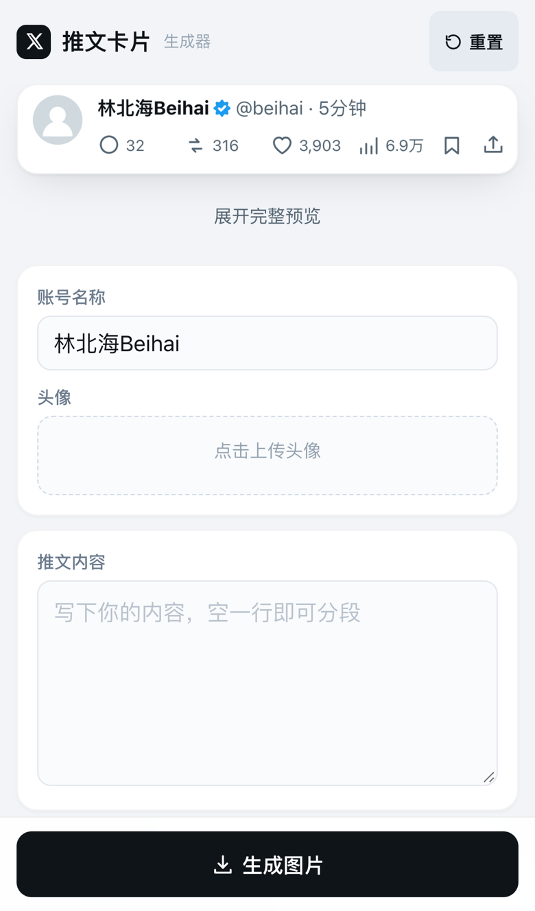
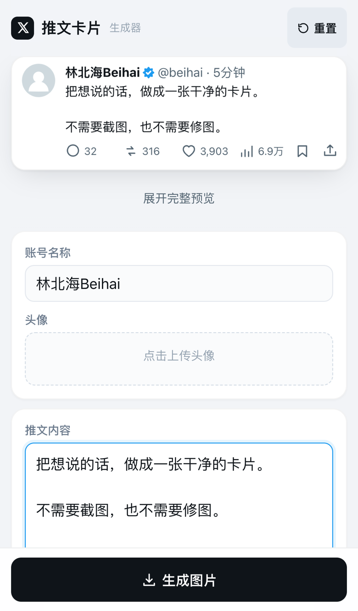
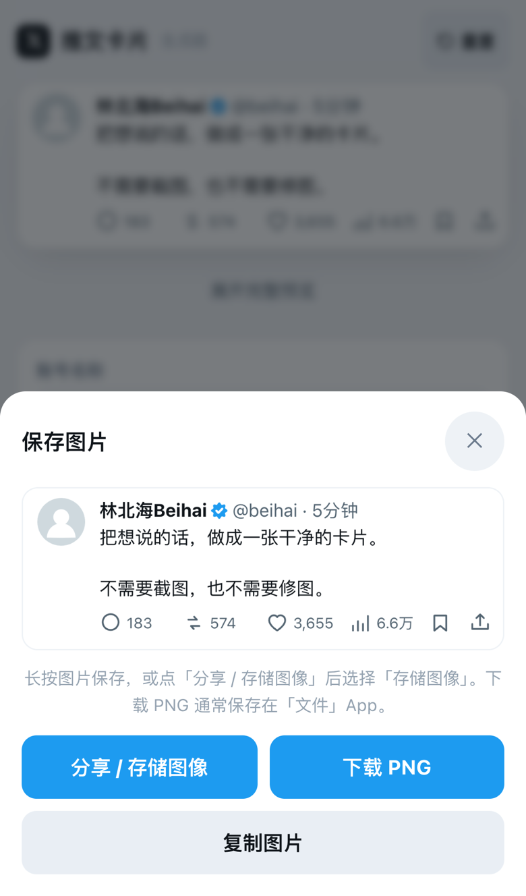

# X_moniqi

在浏览器里把一段文字做成简洁的 X 风格推文卡片：实时预览，一键导出 1206 像素宽的 PNG。手机、电脑都能用，无需安装，图片和文案只在本地处理。

**在线使用：** https://baicaicn23.github.io/X_moniqi/

  
  
  

打开 → 编辑 → 生成并保存

## 快速开始

1. 打开在线版本：https://baicaicn23.github.io/X_moniqi/ ；在电脑上也可以下载 `index.html`，直接用浏览器打开。
2. 填写账号名称，上传头像，输入推文正文。需要更多控制时，展开“高级设置”。
3. 点击“生成图片”，然后保存

- **简洁编辑**：主界面只有账号名称、头像和正文，其余选项收进“高级设置”。
- **实时预览**：输入即更新，手机端可展开查看完整卡片。
- **自动用户名**：中文常用字转拼音首字母，英文和数字保留并转小写；也可手动修改。
- **高级设置**：用户名、蓝标（模拟样式）、发布时间、配图、互动数据和主题。
- **随机互动数据**：默认“一般”档位，生成时随机；手动改过的数值会保留。
- **浅色 / 深色主题**，导出宽度 1206 像素。
- **手机保存**：支持长按保存和下载，浏览器支持时还可调用系统分享与复制。
- **本地处理**：头像、配图和文案都不会上传到服务器。

## 默认设置

| 设置     | 默认值               |
| -------- | -------------------- |
| 账号名称 | 林北海Beihai         |
| 用户名   | `beihai`             |
| 正文     | 空白                 |
| 蓝标     | 开启（模拟样式）     |
| 发布时间 | 5分钟                |
| 互动数据 | 一般档位，生成时随机 |

“重置”会恢复以上默认值，并清除已上传的图片和高级设置中的修改。随机互动数据不会改变发布时间；下载、复制和分享使用的都是同一张已生成的图片，不会再次随机。

## 技术实现

整个应用只有一个 `index.html`，使用 HTML、CSS、原生 JavaScript 和 Canvas 2D 绘制，没有构建步骤，也没有后台服务。PNG 由 Canvas 导出；浏览器支持时，通过 Web Share API 调起系统分享菜单。卡片文字使用设备字体渲染。

## 说明与限制

- 已收到维护者反馈：iPhone 实机使用正常。不同系统版本和浏览器的保存菜单可能有所差异。
- 发布前检查过 JavaScript 语法、HTML ID 唯一性，以及用户名缩写、默认档位、随机范围和固定发布时间等逻辑。
- 没有自动保存和离线缓存，刷新或关闭页面前请先导出图片；添加到主屏幕不代表支持离线使用。
- 在线访问依赖网络和 GitHub Pages；在线版本会随项目更新，需要固定版本时可下载或自行部署。
- 本项目是独立的卡片制作工具，不隶属于 X，也不连接或发布到 X。账号、认证与互动数据都是模拟视觉元素，请勿将生成的图片冒充为真实发布记录。
